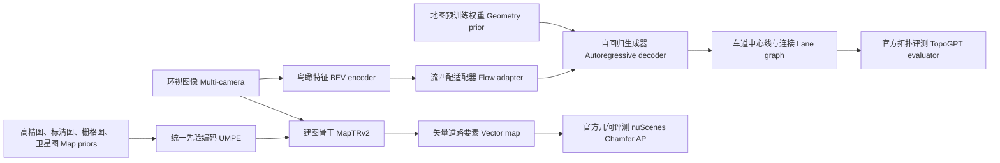

# TopoGPT 与 UMPE 复现现场

主机：`manner-3090-1023`。根目录：`/root/autodl-tmp/manner-repro`。
当前目标是复现官方权重的验证结果，再以真实 GPU smoke 验证训练、保存、恢复和评价入口。完整重新预训练、全量微调尚未启动，也未承诺其计算预算。

## 固定来源

- TopoGPT：[官方代码](https://github.com/buaa-colalab/TopoGPT)，commit `6a96f542e3ee4a7535fa3e54e39a52812e74bbcf`；[论文](https://arxiv.org/abs/2606.31814)；[官方权重](https://huggingface.co/datasets/MatrixF/VectorMapPrior)。
- UMPE：[官方代码](https://github.com/Ethan-Zheng136/UMPE)，commit `66164113780fdc5a73e78c26c8ec234154e123e1`；[论文](https://arxiv.org/abs/2605.02762)；先验来自作者的 `rethinking123/UMPE-Prior`；基础和微调权重来自作者 README 链接的 Google Drive。
- OpenLane-V2：官方 devkit v1.1.0，commit `4bff01854622e004a9a6513240ce6539351b636d`。TopoGPT 使用自身提供的评测代码，不能把其指标直接当作 OpenLane OLS。
- nuScenes：优先读取 `/root/autodl-pub/nuScenes`；完整验证集 150 个场景、6,019 帧；另选 `scene-0001` 作为训练 smoke 数据，绝不混入正式评价。

## 环境与入口

- `topogpt`：Python 3.10，PyTorch 2.1.0+cu118，torchvision 0.16.0+cu118。
- `umpe`：Python 3.8，PyTorch 1.9.1+cu111，torchvision 0.10.1+cu111，MMCV-full 1.4.0，MMDetection 2.14.0，MMSegmentation 0.14.1。
- `scripts/install_deps.sh`：完成各自 Python 依赖并验证导入；以实际日志及 `manifests/*deps_ready` 为准。
- `scripts/install_umpe_sdk.sh`：补齐 AV2 SDK、PyArrow 和 Ninja；项目的注册入口会导入 AV2 类，因此 nuScenes 路径也需要这些运行依赖。
- `scripts/build_umpe_extensions.sh`：带 GPU 后编译、导入 CUDA 扩展。
- `scripts/topogpt_eval.sh`、`scripts/umpe_eval.sh`：完整评价入口；真实 GPU smoke 通过前拒绝长跑。
- `scripts/topogpt_smoke.sh`、`scripts/umpe_smoke.sh`：已准备真实 GPU 短程入口，训练约 8 分钟后保存，再用新进程恢复，并运行少量真实验证帧与官方指标。当前无卡，尚未执行。
- `scripts/prepare_openlane.py`：逐帧转换官方 JSON，类型、点采样与 devkit collect(point_interval=1) 对齐；完整验证集和 smoke 数据分目录。
- `scripts/prepare_umpe_infos.py`：沿用官方地图标注、坐标变换和 CAN bus 逻辑；用 SQLite 查询所选帧的元数据，按场景保存中间结果。缓存重复几何提取，已与未缓存输出逐数组核对。
- `scripts/inspect_prior_pickles.py`：低内存检查公开先验的顶层帧键；较小 HD 文件同时通过实际反序列化比对。
- `status.py`：只读准备状态，不导入 PyTorch、不分配 GPU。
- `configs/umpe_reproduce.py`：模型与测试流水线保持官方示例，训练学习率与门控调度采用发布 checkpoint 内保存的值。

## 验证要求

1. 不以 CPU 导入通过代替 GPU smoke。正式长跑前约 10 分钟覆盖真实数据、前后向、finite loss、显存、checkpoint 保存、完整 optimizer/scheduler/global-step 恢复、评价和下一阶段入口。
2. 评测前核对所有帧和图像；不以抽样结果冒充完整验证集结果。
3. 权重、数据源、下载速度、哈希和环境版本保存在 `manifests/`、`logs/`。没有发布方哈希的 Drive 文件只记录本地 SHA-256，并另外验证 checkpoint 可加载性。
4. TopoGPT README 的数据生成 `--save-path` 应传具体 `.pkl` 文件。Hydra 中已经存在的 `paths.data_dir`、`paths.log_dir` 使用普通覆盖参数。图评测辅助模块路径加入 PYTHONPATH，不修改指标实现。
5. 下载缓存可在校验并成功解包后释放；正式数据、原始代码、模型、日志和恢复现场保留。

## 评价目标与口径

| 项目 | 本次首先复现的配置 | 完整验证数据 | 输出与指标 |
|---|---|---|---|
| TopoGPT | 官方 finetune.ckpt、7 路图像、flow 6 步、LoRA 配置、batch 1 | OpenLane-V2 subset A，按官方 v1.1.0 划分 | 中心线、连接图；作者 PR / topology / graph 评价 |
| UMPE | MapTRv2 + 官方四类先验，首先评价 ft 权重；基础权重也已保存 | nuScenes 150 个验证场景、6,019 帧 | divider、ped_crossing、boundary；Chamfer AP 阈值 0.5 / 1.0 / 1.5 m |

两者输入条件和指标不同，不直接用分数相互排名。UMPE 此配置使用外部 HD/SD、卫星图与栅格先验，不能标为纯无图结果。

[TopoGPT 论文表 1](https://arxiv.org/html/2606.31814v1) 的 subset A 参考值依次为：M-P 45.6、M-R 42.6、M-T 24.4、G-IoU 54.4、SDA 26.9、G-F1 60.3、T-F1 47.4、JT-F1 35.7、APLS 28.7。这里使用作者的指标定义，不能等同 OpenLane OLS。

[UMPE 论文主表](https://arxiv.org/html/2605.02762v1) 的 MapTRv2 + UMPE 参考为：pedestrian crossing AP 66.6、divider AP 67.2、boundary AP 68.2、mAP 67.4。论文主表标注 24 epochs，但发布的基础和 ft checkpoint 元数据分别记录 epoch 29 / 44，内嵌配置为 72 epochs；因此先如实报告公开权重的实测值，不预设其与主表训练预算完全一致。

## 工程修正与数据细节

- `patches/umpe_engineering.patch` 保存对 UMPE 的全部源码差异：补齐官方测试入口中被 `assert False` 禁用的 `--out` 保存分支，同时保存指标 JSON；调整旧 mmdetection3d 的依赖声明，使其与安装并验证导入的 NumPy / Numba / NetworkX 版本一致。CUDA 算子执行仍待带卡验证。
- UMPE 官方栅格 SD 压缩包缺少本次验证集中的 16 帧。保留官方 `LoadSDRasterFromFile` 的白图回退，不伪造缺失文件；帧号在 `manifests/auxiliary_assets.json`。卫星图覆盖全部所选帧。
- OpenLane 官方 sample 只有训练数据。训练 smoke 使用该 sample；验证 smoke 从正式验证集取 8 帧，独立保存，完整评价继续使用全量验证集。
- nuScenes 另备训练场景 `scene-0001` 的 40 帧作 smoke。全量训练集、TopoGPT 的 3.3M 预训练数据及 UMPE 的 AV2 / VAD 评测数据未准备；本次尚未启动从头预训练、全量微调或跨任务结果复现。
- CAN bus 文件物理存储在 `/root/manner-repro-download-cache/can_bus`，原 `data/can_bus` 中保留逐文件链接。迁移经 CRC 校验并原子替换，原始公共盘压缩包未改动。
- 无卡模式下的导入、格式核对、下载与 CPU 准备是工程开销；真实 GPU smoke / 必要重放另计，不占正式训练步数预算。恢复审计校验模型、优化器、调度、步数、RNG，UMPE 额外校验 FP16 scaler；当前没有任何 GPU 通过标记。
- 完整评价按模型和时间建立独立输出目录；评价结束检查预测覆盖完整验证集，保留每次运行的结果。

## 带卡后的执行顺序

1. 确认实际 GPU、内存及磁盘余量，更新本地代理隧道（如仍需联网）。
2. 先运行 `bash scripts/topogpt_smoke.sh`；并行完成 UMPE 的 CUDA 扩展构建与先验实际加载检查。
3. TopoGPT smoke 通过后运行 `bash scripts/topogpt_eval.sh`，同时继续 CPU 准备和核验。
4. UMPE 扩展与完整数据就绪后运行 `bash scripts/umpe_smoke.sh`，通过后运行 `bash scripts/umpe_eval.sh`。用 `UMPE_CHECKPOINT` 可显式选择基础权重。
5. 核对全量帧覆盖、指标口径、结果与环境；取回日志、指标、补丁和部署记录。按长期规则完成后续依赖工作后再判断关机；无卡模式不关机。

## 当前限制

主机已由用户确认处于无卡模式，资源限制为 0.5 核 CPU、2 GiB 内存。真实 GPU 验证尚未进行。完成状态以实测记录为准，不能把本文件或入口脚本的存在视为复现成功。
