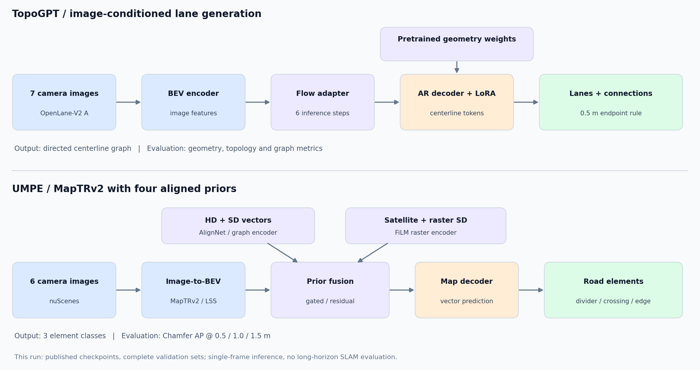
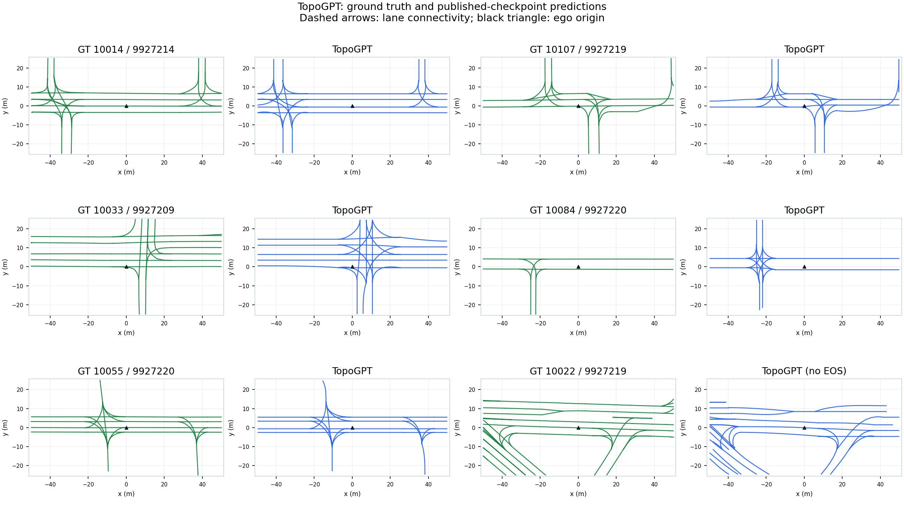
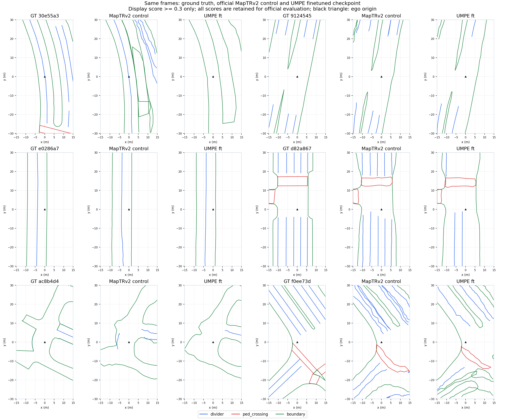

# TopoGPT 与 UMPE：3090 复现结果

完成时间：2026-10-24T03:00:04.810973+08:00。主机 `manner-3090-1023`；工作目录 `/root/autodl-tmp/manner-repro`。

已完成作者发布权重在完整验证集上的运行、官方指标计算及结果覆盖检查。两套训练 smoke 均覆盖真实数据、前后向、有限 loss/非零梯度、checkpoint 保存、独立进程完整状态恢复和评价入口。未进行从头预训练或全量重新微调。

## 结构与输入



TopoGPT 使用图像推理，地图先验已学入权重；本次 UMPE 配置额外读取四类地图先验。两个任务的输入、输出及指标不同，分数不能相互排名。

TopoGPT 的官方评测将生成的中心线按默认 0.5 m 端点距离构建有向连接；连接指标包含生成几何与这一构图步骤的共同效果。UMPE 本次配置 `queue_length=1`、`video_test_mode=False`。本轮未测试长时序在线地图跟踪、SLAM/VIO 或定位与地图联合优化。

## TopoGPT：OpenLane-V2 subset A

完整 4,806 帧、7 路图像。预测键与官方划分逐一相等；使用作者提供的 PR、topology、graph 指标。下表均乘以 100，差值为百分点。参考来自 [论文表 1](https://arxiv.org/html/2606.31814v1)。

| 指标 | 本次实测 | 论文参考 | 差值 |
|---|---:|---:|---:|
| M-P | 45.53 | 45.6 | -0.07 |
| M-R | 42.65 | 42.6 | +0.05 |
| M-T | 24.37 | 24.4 | -0.03 |
| G-IoU | 54.16 | 54.4 | -0.24 |
| SDA | 27.11 | 26.9 | +0.21 |
| G-F1 | 60.12 | 60.3 | -0.18 |
| T-F1 | 47.25 | 47.4 | -0.15 |
| JT-F1 | 35.49 | 35.7 | -0.21 |
| APLS | 28.82 | 28.7 | +0.12 |

诊断：16 帧在默认生成上限内未输出 EOS；0 帧最终中心线为空。保留作者默认生成上限和原始预测，不因这些情况筛除验证帧。对应帧键见 `predictions.coverage.json`。

## UMPE：nuScenes MapTRv2 + 四类先验

两份 checkpoint 均完成官方 150 个验证场景、6,019 帧，采用原测试代码的单 rank、无打乱顺序。Chamfer AP 取 0.5 / 1.0 / 1.5 m 阈值平均。参考来自 [论文 MapTRv2 主表](https://arxiv.org/html/2605.02762v1)。

| 指标 | 基础权重 | 微调权重 | 论文参考 |
|---|---:|---:|---:|
| 人行横道 | 48.84 | 52.47 | 66.6 |
| 分隔线 | 39.97 | 43.27 | 67.2 |
| 道路边界 | 70.36 | 70.69 | 68.2 |
| mAP | 53.06 | 55.48 | 67.4 |

**UMPE 的论文主表成绩尚未对齐。** 微调权重本轮 mAP 为 55.48，不能据此宣称已复现 67.4。已核对 6,019 帧顺序、54,788 个评分真值数组与转换标注逐值相等、类别映射、模型严格加载、先验缓存以及 CUDA 算子数值；融合 alpha 在两份 checkpoint 中均约为 0.6，并非未恢复成默认零值。固定抽样图中可见分隔线漏检，不能仅由边界 AP 较高推断全模型达到论文水平。

对 16 个等间隔样本的 96 路相机，还独立用 4×4 齐次变换重算了相机到 LiDAR 外参，最大误差约 1.01e-12；内参、时间戳、图像路径与关键帧标志一致。该抽检及定性样例未发现整体坐标翻转，但不据此断言已排除所有数据与实现差异。

另外独立检查了全部 6,019 帧的卫星图关联：时间戳与地图区域均唯一匹配，文件名中的全局 x/y 与车辆位姿逐值一致。等间隔抽取的 32 帧卫星图和栅格图均可解码且有非空内容；该检查不等于独立验证发布图像的地理定位和旋转精度。详细记录见 `reports/diagnostics/umpe_raster_input_audit.json`。

发布文件还存在版本对应关系的限制：基础/微调文件是 epoch 29/44，其元数据指向的历史最佳文件分别是 epoch 26/42，历史最佳 mAP 记录为 68.65/70.91。这些是训练历史记录，未在本轮得到验证，也不能替代实测。

[上游 issue #5](https://github.com/Ethan-Zheng136/UMPE/issues/5) 中，其他复现者在矢量先验版本也报告了约 55–57 mAP；作者 2026-10-22 回复称本地权重表现更高。截至本次核查，配置/权重/先验组合的差异仍未得到明确解释。该 issue 与本轮四类先验配置不同，只能作为相关线索，不能证明原因相同。公开讨论快照与本地诊断保存在 `manifests/upstream/`、`reports/diagnostics/`。

### 官方 MapTRv2 对照

另用官方图像输入 MapTRv2 R50 24-epoch 权重，在相同 6,019 帧、环境与评分实现上进行诊断对照。本次 mAP **61.38**，相对[官方仓库 61.4](https://github.com/hustvl/MapTR/blob/maptrv2/README.md) 为 **-0.02** 个百分点。

该对照接近官方参考值，支持公共图像数据、几何变换和基础评分链路基本正确；UMPE 的剩余差距更需要核对发布权重、先验资产与训练配置的对应关系。对照不能证明 UMPE 特有的数据分支完全正确。

基线模型和测试管线与权重内嵌配置一致，严格加载无缺失或多余参数，先做 8 帧真实 GPU 推理与官方评分再运行全量。UMPE 数据集构造器需要先验字典，因此仅补充缓存路径以满足构造；基线管线只收集图像，模型没有地图编码或融合模块。新对照采用 OpenCV 单线程，属于独立工程诊断开销，不计入 UMPE 训练或改变其原始预测。

对照结果：`/root/autodl-tmp/manner-repro/results/diagnostic/maptrv2_baseline_20261023T171236Z`；预测 SHA-256 `85be9d950f34533644ce763d57b0c303592c33eaa7385fbd4e653571a1c53ebd`。

| 对照指标 | MapTRv2 实测 | UMPE 微调实测 |
|---|---:|---:|
| 分隔线 | 61.35 | 43.27 |
| 人行横道 | 60.16 | 52.47 |
| 道路边界 | 62.63 | 70.69 |

论文主表标注 24 epochs；发布的基础/微调 checkpoint 元数据分别为 epoch 29/44，内嵌训练配置为 72 epochs。因此本次是公开权重的实测复现，不能声称复现了论文的严格训练预算。原始栅格 SD 包缺少验证集 16 帧，保留官方白图回退，未删除这些帧或补造先验。

## 真实 GPU 验收

| 项目 | TopoGPT | UMPE |
|---|---|---|
| 训练 smoke | 440 步 / 483.1 秒 | 320 步 / 503.1 秒 |
| 独立进程恢复 | 440 → 443 步 | 320 → 360 步 |
| 恢复校验 | 模型、优化器、调度器、步数、RNG | 模型、优化器、epoch/iter、FP16 scaler、RNG、下一步学习率 |
| 小规模评价 | 8 帧，三组官方指标 | 8 帧，其中 4 帧缺失栅格先验 |

RNG 已恢复，但未断言跨进程数据顺序和整段训练轨迹逐位一致。smoke 权重不用于完整验证。GKT 与 MMCV 注意力 CUDA 算子的前向、反向对照误差均小于 1e-6。

## 工程处理与可复查证据

- TopoGPT 官方源码未修改，checkpoint 内保存的采样/损失/优化器/调度配置与仓库一致。
- UMPE 源码差异仅为结果持久化、旧依赖声明和 Numba 异常类导入，见 `patches/umpe_engineering.patch`。
- 修复了 smoke 审计中 RNG 元数据 JSON 序列化和旧 PyTorch 字节视图兼容问题；从原始第 320 步 checkpoint 恢复，未重复该训练段。失败现场与日志保留。
- 全量评测最初遇到旧数据集 `dict_keys` 无法经 spawn 序列化；使用与 smoke 相同的 `workers_per_gpu=0` 后运行。模型、输入及评分未更改。
- 先验按帧键无损缓存。验证集 21,050 个 HD 数组、945,554 个 SD 数组保存前后哈希一致；原始作者文件保留。
- 两套任务部分时间共享 GPU，记录了资源遥测；耗时不作为单模型 FPS 基准。
- UMPE 两份权重最终并行评价，等待队列父进程已停止，未中断任何模型进程或重复执行已完成帧。OpenCV 单线程在 8 个真实样本上与默认 112 线程输出逐字节一致，数据管线约快 28%；考虑已运行进度，本轮未重启或更改正式进程，证据见 `manifests/opencv_pipeline_equivalence.json`。
- UMPE 微调/基础权重进入 CPU 评分后，分别将进程及子进程限制在 8/12 个逻辑核，给仍在 GPU 推理的任务保留 CPU 配额。保留官方 worker 数、计算函数与样本顺序；CPU 亲和性记录见 `manifests/umpe_*_metric_cpu_affinity.json`。
- TopoGPT 在 8 个真实样本上的额外诊断显示，教师强制损失约占计算时间 14%；本轮保留原始验证入口。该测量与 CPU 线程对比均为额外工程开销，未计入正式指标样本。
- `scripts/score_umpe_predictions.py` 直接调用官方格式化与评分函数，读取保存的预测、帧元数据和真值。8 帧 CPU 回放全部指标与原官方输出完全一致，未初始化 CUDA、加载模型、图像或先验。
- 数据盘空间回收：两份 UMPE 及 MapTRv2 对照的评分中间文件逐文件 SHA-256 核验后压缩归档，取回本机并验证后释放远端归档副本；原始预测和指标保持不变。TopoGPT 预训练权重迁到系统盘，原路径用符号链接保留，迁移前后哈希一致；正在评价的 finetune 权重未移动。详见 `manifests/score_cache_archive.json`、`manifests/control_score_cache_archive.json` 与 `manifests/pretrain_weight_storage.json`。

## 重新运行

```bash
cd /root/autodl-tmp/manner-repro
bash scripts/topogpt_eval.sh
bash scripts/umpe_eval_pair.sh
/root/miniconda3/bin/python scripts/runtime_status.py
```

环境分别为 `topogpt`（Python 3.10 / torch 2.1.0+cu118）和 `umpe`（Python 3.8 / torch 1.9.1+cu111 / MMCV 1.4.0）。入口脚本自动选择环境与权重，重复运行使用独立结果目录。

完整结果路径：

- `topogpt`：`/root/autodl-tmp/manner-repro/results/topogpt/run_20261023T152334Z`，预测 SHA-256 `95328564786fb40c78bfd685c83756989c7fbf2683b6b7748f95a734bd8fecda`。
- `umpe_finetuned`：`/root/autodl-tmp/manner-repro/results/umpe/finetuned_20261023T154019Z`，预测 SHA-256 `d7cf6ab93bab4539bdbc7db9372c6776788cbe8813d325f21a7dc0f100bd2e5a`。
- `umpe_base`：`/root/autodl-tmp/manner-repro/results/umpe/base_parallel_20261023T155704Z`，预测 SHA-256 `824779a51308a2177066685630f5a1f4ae15828104d0c55d956fd87aef2c0429`。

只重算 UMPE 指标，无需 GPU 推理：

```bash
CUDA_VISIBLE_DEVICES= OMP_NUM_THREADS=1 OPENBLAS_NUM_THREADS=1 \
/root/miniconda3/envs/umpe/bin/python scripts/score_umpe_predictions.py \
  --pred /root/autodl-tmp/manner-repro/results/umpe/finetuned_20261023T154019Z/predictions.pkl \
  --infos data/nuscenes/nuscenes_map_infos_temporal_val.pkl \
  --gt data/nuscenes/nuscenes_map_anns_val.json \
  --out-dir results/metric_replay/umpe_finetuned_cpu \
  --reference /root/autodl-tmp/manner-repro/results/umpe/finetuned_20261023T154019Z/predictions.metrics.json
```

为保护旧结果，CPU 回放的 `--out-dir` 必须是尚不存在的目录。离线交付包在 `evaluation_inputs/` 中包含验证标注与帧元数据；原始图像、先验、权重和环境仍保留于远端。

后续需要独立准备/预算的项目：全量重新训练、TopoGPT 3.3M 地图预训练、OpenLane subset B、UMPE 的 AV2/MapQR/VAD 与先验消融。上述项目未作为本次已完成结果。

## 定性核对

TopoGPT 固定随机种子选场景、每场景取首帧；若存在未生成 EOS 的帧，最后一例展示其中一帧。UMPE 在完整验证序列上等间隔取 6 帧，仅为显示清晰采用 0.3 分数阈值；正式指标保留全部预测。精确帧键及选择规则在 `figures/selection.json`，这些例子不替代总体统计。

在本次固定样例中，TopoGPT 的 10033、10084 场景可见额外路口分支，说明总体指标接近论文并不等于局部拓扑可靠。UMPE 的首个样例可见分隔线遗漏，对照 MapTRv2 保留了更多分隔线；这些是对应帧的直观观察，不能据此推断所有场景或确定精度差距的根因。




